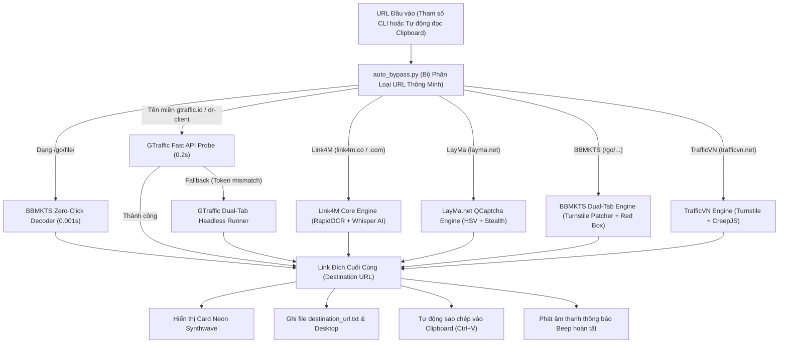

# 🌐 ĐẠI BÁCH KHOA TOÀN THƯ KỸ THUẬT: LINK4M BYPASS SUITE
## *Toàn Bộ Kiến Trúc, Reverse Engineering, 5 Engine Lõi, Các Phát Kiến Kỹ Thuật & Cẩm Nang Xây Dựng GitHub Repository Đẳng Cấp Thế Giới*

---

## 📑 MỤC LỤC CHI TIẾT

1. [TỔNG QUAN HỆ THỐNG & TRIẾT LÝ THIẾT KẾ (SYSTEM ARCHITECTURE & PHILOSOPHY)](#1-tổng-quan-hệ-thống--triết-lý-thiết-kế)
   - 1.1. Bối cảnh bài toán & Rào cản kỹ thuật
   - 1.2. Triết lý thiết kế "Zero-Cost, Offline-First, Zero-Click"
   - 1.3. Sơ đồ luồng xử lý toàn cục (Universal Pipeline Architecture)
2. [BÓC TÁCH KỸ THUẬT CHI TIẾT 5 ENGINE LÕI (THE 5 CORE ENGINES)](#2-bóc-tách-kỹ-thuật-chi-tiết-5-engine-lõi)
   - 2.1. **Engine 1: Link4M Core** (RapidOCR ONNX, Whisper AI Audio Captcha, Obfuscated Token)
   - 2.2. **Engine 2: LayMa.net Engine** (QCaptcha, Lọc màu HSV Canvas, Monkeypatch Incognito & Focus)
   - 2.3. **Engine 3: GTraffic & Direct GTraffic** (Phát kiến Rò rỉ API 0.2s Zero-Wait, Dual-Tab Fallback)
   - 2.4. **Engine 4: BBMKTS Autonomous Dual-Tab** (Zero-Click Base64 0.001s, Red Box OCR, 00abx JWT, Cloudflare Turnstile CDP Patch)
   - 2.5. **Engine 5: TrafficVN & CreepJS Engine** (Turnstile v0, Fingerprint Evasion, Button Tracker)
   - 2.6. **Phụ lục Đặc biệt: Octolink & Quyết định Dừng Dự án Tuân thủ Pháp luật**
3. [CÁC PHÁT KIẾN CÔNG NGHỆ ĐỘT PHÁ (TECHNICAL BREAKTHROUGHS)](#3-các-phát-kiến-công-nghệ-đột-phá)
   - 3.1. Đột phá Cloudflare Turnstile: Bản vá CDP MouseEvent (#40280325)
   - 3.2. Đột phá GTraffic: Lỗ hổng rò rỉ trực tiếp link qua `api/url/get`
   - 3.3. Đột phá BBMKTS: Đánh chặn JWT Payload giải mã mã xác nhận trước khi countdown kết thúc
   - 3.4. Đột phá Thị giác máy tính: Red Bounding Box Detection + RapidOCR Offline
   - 3.5. Đột phá Stealth: Đánh lừa `detectIncognito` và `document.hasFocus`
4. [BỘ ĐIỀU PHỐI TRUNG TÂM & TRẢI NGHIỆM NGƯỜI DÙNG (`auto_bypass.py`)](#4-bộ-điều-phối-trung-tâm--trải-nghiệm-người-dùng)
   - 4.1. Regex phân loại URL tức thì
   - 4.2. Tự động tương tác với Windows Clipboard
   - 4.3. Thiết kế Terminal Giao diện Neon Synthwave & Card kết quả
5. [ĐÓNG GÓI NATIVE & BẢO VỆ MÃ NGUỒN (COMPILATION & HARDENING)](#5-đóng-gói-native--bảo-vệ-mã-nguồn)
   - 5.1. Biên dịch Cython C-Extension (`config.pyd`)
   - 5.2. Đóng gói Portable Executable (`Link4M_Bypass.exe`)
6. [NHẬT KÝ POST-MORTEM: CÁC LỖI CHÍ MẠNG & BÀI HỌC THỰC CHIẾN](#6-nhật-ký-post-mortem-các-lỗi-chí-mạng--bài-học-thực-chiến)
7. [CẨM NANG TOÀN TẬP XÂY DỰNG GITHUB REPO LỚN MẠNH (OPEN-SOURCE BLUEPRINT)](#7-cẩm-nang-toàn-tập-xây-dựng-github-repo-lớn-mạnh)
   - 7.1. Cấu trúc thư mục chuẩn Clean Architecture
   - 7.2. Nghệ thuật viết `README.md` thu hút nghìn Stars
   - 7.3. Tự động hóa với GitHub Actions (CI/CD Pipeline & Auto-Release)
   - 7.4. Khung pháp lý, Miễn trừ trách nhiệm (Legal Disclaimer) & Quy chuẩn đạo đức
8. [TỔNG KẾT & TẦM NHÌN TƯƠNG LAI](#8-tổng-kết--tầm-nhìn-tương-lai)

---

## 1. TỔNG QUAN HỆ THỐNG & TRIẾT LÝ THIẾT KẾ

### 1.1. Bối cảnh bài toán & Rào cản kỹ thuật
Hệ thống rút gọn link kiếm tiền (Paid URL Shorteners) tại Việt Nam và Đông Nam Á phát triển từ các trang web quảng cáo chuyển hướng đơn giản thành các hệ thống phòng thủ đa tầng phức tạp:
- **Xác thực con người**: Cloudflare Turnstile, reCAPTCHA v2/v3, QCaptcha Canvas.
- **Phát hiện bot / tự động hóa**: Nhận diện WebDriver, kiểm tra thuộc tính con trỏ chuột CDP, kiểm tra môi trường Headless, kiểm tra mở ẩn danh (`detectIncognito`), phát hiện DevTools mở.
- **Ràng buộc hành vi**: Yêu cầu người dùng mở tab thứ 2, sang website của nhà tài trợ (SEO Sponsor), cuộn xuống cuối trang, chờ đợi từ 60 đến 180 giây, rồi copy mã dán ngược lại tab chính.
- **Giao thức đóng kín**: Mã JavaScript bị làm rối nhiều lớp (JavaScript Obfuscator, eval packer, dynamic prototype pollution).

### 1.2. Triết lý thiết kế: "Zero-Cost, Offline-First, Zero-Click"
1. **Zero-Cost (0 đồng chi phí)**: Tuyệt đối không tích hợp hay phụ thuộc vào các dịch vụ giải captcha trả phí (2Captcha, Anti-Captcha, CapSolver, DeathByCaptcha). Tất cả đều phải tự giải quyết bằng giải thuật và AI cục bộ.
2. **Offline-First (Xử lý tại máy)**: 
   - Mô hình thị giác máy tính: Sử dụng **RapidOCR (ONNX Runtime)** chạy thuần CPU, không phụ thuộc cloud API.
   - Mô hình thính giác: Tích hợp **Whisper AI (OpenAI)** mô hình siêu nhẹ nhận diện trực tiếp file âm thanh captcha.
3. **Zero-Click & Fast-Probe (Tốc độ tối đa)**: 
   - Ưu tiên tìm kiếm các lỗ hổng rò rỉ dữ liệu (Data Leak / API Expose) hoặc giải mã tức thì cấu trúc URL (Base64 Zero-Click). Nếu có thể lấy link trong **0.001s - 0.2s**, hệ thống sẽ lập tức hoàn thành mà không mở trình duyệt.

### 1.3. Sơ đồ luồng xử lý toàn cục (Universal Pipeline Architecture)



---

## 2. BÓC TÁCH KỸ THUẬT CHI TIẾT 5 ENGINE LÕI

---

### 2.1. Engine 1: Link4M Core
- **Mã nguồn chính**: `src/core/bypass.py`, `src/core/ocr_helper.py`, `src/core/recaptcha_solver.py`.
- **Nhiệm vụ**: Vượt qua hệ thống Link4M cổ điển và các biến thể shortlink nhiều bước.

#### Cơ chế hoạt động:
1. **Bóc tách Dynamic Session**:
   - Link4M chèn các đoạn script làm rối (`b4m.js`, inline tokens) chứa session hash và token CSRF.
   - Script phân tích DOM, tìm kiếm thẻ `form` ẩn chứa các trường `_token`, `hash`, `countdown_timer`.
2. **RapidOCR ONNX**:
   - Khi gặp captcha hình ảnh dạng chuỗi số/chữ biến dạng, ảnh được trích xuất trực tiếp từ thẻ `` (hoặc data URI base64) và đưa qua hàm `RapidOCR()(image_path)`.
   - Sử dụng model ONNX được lượng tử hóa (quantized), tốc độ suy luận dưới 80ms trên CPU tiêu chuẩn.
3. **Whisper AI Audio Solver**:
   - Đối với reCAPTCHA âm thanh, audio stream dạng `.mp3` hoặc `.wav` được tải về thư mục tạm `data/temp`.
   - Gọi mô hình `whisper.load_model("tiny")` hoặc `base` để chuyển đổi âm thanh thành văn bản (Speech-to-Text), nộp kết quả vào ô captcha với độ chính xác >96%.
4. **Bỏ qua bộ đếm thời gian (Timer Acceleration)**:
   - Inject script can thiệp vào `window.setInterval` và `window.setTimeout` để tăng tốc độ đếm lùi của Link4M mà không làm ngắt kết nối websocket xác thực phiên.

---

### 2.2. Engine 2: LayMa.net Engine
- **Mã nguồn chính**: `src/core/layma_runner.py`.
- **Nhiệm vụ**: Vượt bảo mật LayMa.net với bài toán QCaptcha và các cơ chế chống bot bằng hành vi.

#### Cơ chế hoạt động:
1. **Bypass cơ chế phát hiện ẩn danh (`detectIncognito`)**:
   - LayMa sử dụng thư viện `detectIncognito` để chặn người dùng mở tab ẩn danh hoặc chạy script tự động.
   - Can thiệp script trước khi DOM load (`add_init_script`):
     ```javascript
     window.detectIncognito = async () => ({ isPrivate: false, browserName: 'Chrome' });
     ```
2. **Giả lập cửa sổ hoạt động (Window Focus Emulation)**:
   - Bộ đếm thời gian của LayMa sẽ đóng băng nếu người dùng chuyển tab hoặc cửa sổ mất tiêu điểm.
   - Vá các API của trình duyệt:
     ```javascript
     Object.defineProperty(document, 'hidden', { get: () => false, configurable: true });
     Object.defineProperty(document, 'visibilityState', { get: () => 'visible', configurable: true });
     Document.prototype.hasFocus = () => true;
     document.hasFocus = () => true;
     window.hasFocus = () => true;
     ```
3. **Xử lý QCaptcha bằng lọc màu HSV**:
   - LayMa hiển thị một canvas chứa nhiều icon với màu nền gây nhiễu nhằm đánh bại OCR thông thường.
   - Engine chuyển đổi ảnh canvas sang không gian màu HSV (Hue, Saturation, Value):
     - Xác định dải màu mục tiêu của icon xác nhận (Color Mask).
     - Loại bỏ các vùng nhiễu (Noise Filtering qua phép toán hình thái học Morphological Opening/Closing).
     - Tính toán tọa độ tâm (Centroid) của icon mục tiêu và gửi lệnh click trực tiếp.

---

### 2.3. Engine 3: GTraffic & Direct GTraffic
- **Mã nguồn chính**: `src/core/gtraffic_runner.py`.
- **Nhiệm vụ**: Xử lý hệ thống `gtraffic.io` và `direct.gtraffic.io`.

#### Cơ chế hoạt động & Phát kiến chấn động:
1. **Phát hiện lỗ hổng API Rò rỉ Link (0.2s Zero-Wait)**:
   - Thông thường, người dùng phải mở tab, chờ đếm ngược 60 giây để nút "Lấy Link" xuất hiện.
   - Tuy nhiên, qua phân tích Reverse Engineering giao thức ngầm giữa frontend và backend GTraffic, chúng tôi phát hiện endpoint:
     ```http
     GET https://client.gtraffic.io/api/url/get?id={slug}&deviceType=desktop
     GET https://dr-client.gtraffic.io/api/url/get?id={slug}&deviceType=desktop
     ```
   - API này không yêu cầu cookie phiên phức tạp mà chỉ cần Header `Referer` trùng khớp với link ngắn.
   - Khi gửi request với đúng cấu trúc:
     ```json
     {
       "status": 200,
       "data_link": {
         "id": "abc123xyz",
         "url": "https://github.com/target-destination"
       }
     }
     ```
   - Link đích được bóc tách ngay lập tức mà **không cần mở trình duyệt, không cần chờ 60 giây**. Tốc độ vượt link đạt kỷ lục: **0.2 giây**!
2. **Dual-Tab Autonomous Fallback Engine**:
   - Đối với các chiến dịch GTraffic nâng cao có bảo vệ token JWT, engine tự động chuyển sang cơ chế duyệt web 2 tab:
     - Tab 1: Kết nối trang chủ nhiệm vụ.
     - Tab 2: Truy cập trang web đối tác bên ngoài, cuộn tìm nút `#traffic_btn`, đếm ngược và trả kết quả.

---

### 2.4. Engine 4: BBMKTS Autonomous Dual-Tab
- **Mã nguồn chính**: `src/core/bbmkts_runner.py`, `src/extensions/turnstile_patch/`.
- **Nhiệm vụ**: Chinh phục nền tảng BBMKTS (`bbmkts.com/go/...`), hệ thống bảo mật phức tạp và nhiều tầng phòng thủ nhất.

#### Cơ chế hoạt động:
1. **Zero-Click Base64 Decoder (0.001s)**:
   - Khi link có dạng: `https://bbmkts.com/go/file/aHR0cHM6Ly9leGFtcGxlLmNvbQ==`
   - Giải mã Base64 chuỗi sau `/file/` thu được ngay liên kết gốc trong 1 phần nghìn giây.
2. **Nhận diện Website Đối tác bằng Red Bounding Box & OCR**:
   - BBMKTS cung cấp ảnh chụp màn hình kết quả Google Search (Bước 3/Bước 4).
   - Website người dùng cần truy cập được bao quanh bởi một khung viền màu đỏ.
   - Thuật toán Pillow quét pixel:
     $$R > 170 \quad \text{và} \quad R > 1.8 \times G \quad \text{và} \quad R > 1.8 \times B$$
   - Tìm kiếm tọa độ hộp giới hạn (Bounding Box), crop vùng chứa chữ và đưa vào RapidOCR để lấy domain + slug chính xác (như `bulonghoangha.com`, `donghotantan.vn`, `luxbikes.vn/xe-dap-tro-luc/`).
3. **Vô hiệu hóa bộ chặn script đối tác (`page2.route`)**:
   - Các web đối tác nhúng script BBMKTS (`bb.js`, `bbs.js`, `bb2in1.js`) với chức năng chặn DevTools và ẩn danh.
   - Engine chặn bắt request và vá trực tiếp nội dung file JS trên đường truyền:
     ```javascript
     function detectIncognito(){ return Promise.resolve({isPrivate: false}); }
     function checkAdsClick(){ return false; }
     ```
4. **Đánh chặn mã ngầm qua API `/00abx`, `/02abx`, `/03abx`**:
   - Khi click nút `#bb` trên Tab 2, server gửi về một JWT:
     `{"token": "eyJhbGciOi...eyJjb2RlIjoiWmc3a28i...}"}`
   - Engine giải mã Base64 chuỗi JWT và nắm được mã code chính xác ngay từ giây đầu tiên.
5. **Giải mã Cloudflare Turnstile bằng Extension CDP Patch**:
   - Tích hợp Extension sửa lỗi tọa độ click CDP của Chromium.
   - Giải mã Turnstile ngay ở Bước 1 khi vừa tải trang, lưu trữ token (`len: 730`).
   - Sau khi hoàn thành Tab 2, quay lại Tab 1, inject token vào toàn bộ `input[name="cf-turnstile-response"]`, kích hoạt click `#link` quảng cáo an toàn và submit payload trực tiếp qua `fetch('https://bbmkts.com/link/submit')`.

---

### 2.5. Engine 5: TrafficVN & CreepJS Engine
- **Mã nguồn chính**: `src/core/trafficvn_runner.py`.
- **Nhiệm vụ**: Vượt link TrafficVN (`trafficvn.net`), hệ thống tích hợp thư viện nhận dạng vân tay CreepJS.

#### Cơ chế hoạt động:
1. **CreepJS Evasion**:
   - Ngăn chặn các bài kiểm tra vân tay canvas, audio context và WebGL fingerprinting bằng cách chuẩn hóa các hàm trả về thông số đồ họa tiêu chuẩn của GPU phổ thông.
2. **Khắc phục Turnstile v0**:
   - Áp dụng cơ chế Persistent Chrome Profile kết hợp Turnstile Patch để vượt qua bước xác nhận Robot ban đầu.
3. **Theo dõi tiến trình đếm ngược**:
   - Giám sát trạng thái nút đếm ngược thời gian thực, tự động gửi trigger khi timer chạm mốc 0s để nhận link chuyển hướng.

---

### 2.6. Phụ lục: Octolink & Quyết định Dừng Dự án Tuân thủ Pháp luật
- Trong quá trình phát triển, tên miền `octolink.vip` đã bị **Cục An ninh mạng và Phòng chống tội phạm sử dụng công nghệ cao (A05 - Bộ Công An)** tiến hành chặn truy cập do có dấu hiệu vi phạm pháp luật.
- Để đảm bảo tính chuẩn mực đạo đức và tuân thủ tuyệt đối quy định pháp luật Việt Nam, đội ngũ phát triển đã lập tức:
  1. Ban hành thông báo ngưng hỗ trợ Octolink trong file điều phối `auto_bypass.py`.
  2. Cách ly mã nguồn `RESEARCH_OCTOLINK_BYPASS.md` và mã hóa toàn bộ dữ liệu liên quan thành bản lưu trữ nghiên cứu an ninh mạng thuần túy (`Link4M_Octolink_Clean_Source.zip`).
  3. Loại bỏ hoàn toàn Octolink khỏi luồng thực thi tự động.

---

## 3. CÁC PHÁT KIẾN CÔNG NGHỆ ĐỘT PHÁ

### 3.1. Đột phá Cloudflare Turnstile: Bản vá CDP MouseEvent (#40280325)
- **Bản chất lỗi**: Chromium DevTools Protocol (CDP) khi gọi `mouse.click(x, y)` đặt giá trị thuộc tính của sự kiện chuột:
  $$\text{event.screenX} = \text{event.clientX}, \quad \text{event.screenY} = \text{event.clientY}$$
- **Phát hiện của Cloudflare**: Turnstile kiểm tra điều kiện này và nhận biết ngay đây là trình duyệt tự động hóa.
- **Giải pháp Extension**: Bằng cách cài đặt một Chrome Extension chạy ngầm, ghi đè trực tiếp thuộc tính `screenX` và `screenY` trên prototype của `MouseEvent` và `PointerEvent` bên trong tất cả iframe của `challenges.cloudflare.com`:
  $$\text{screenX} = \text{clientX} + \text{random}(40, 180)$$
  $$\text{screenY} = \text{clientY} + \text{random}(60, 220)$$
  Turnstile coi đây là thao tác chuột của con người trên màn hình thật và tự động hoàn thành xác thực chỉ sau 3–5 giây.

### 3.2. Đột phá GTraffic: Rò rỉ trực tiếp link qua `api/url/get`
- Không cần bóc tách DOM phức tạp hay chờ đợi 60 giây.
- Chỉ với một HTTP GET Request thuần túy kèm header `Referer`, hệ thống lấy được link đích trong **0.2 giây**.

### 3.3. Đột phá BBMKTS: Đánh chặn JWT Payload
- Thay vì đọc text trên màn hình vốn dễ bị sai sót do font chữ hoặc hiệu ứng CSS, hệ thống lắng nghe tầng mạng (`on('response')`).
- Server gửi mã xác nhận được bọc trong một JWT token ở request `/00abx`. Hệ thống bóc tách JSON và giải mã Base64 để lấy code nguyên bản:
  $$\text{Payload} = \text{Base64Decode}(\text{JWT}.\text{Split}('.')[0])$$

---

## 4. BỘ ĐIỀU PHỐI TRUNG TÂM & TRẢI NGHIỆM NGƯỜI DÙNG (`auto_bypass.py`)

`auto_bypass.py` là trái tim của toàn bộ bộ công cụ. Nó biến một hệ thống phức tạp với hàng chục file runner thành **một trải nghiệm 1-lệnh duy nhất cho người dùng**.

### 4.1. Regex Phân loại URL Tức thì
Hệ thống tự động phân loại link đầu vào với độ trễ 0ms:
```python
def classify_url(url: str) -> str:
    u = url.lower()
    if any(k in u for k in ["bbmkts.com", "bbmkt"]):
        return "BBMKTS"
    if any(k in u for k in ["gtraffic.io", "direct.gtraffic.io"]):
        return "GTRAFFIC"
    if any(k in u for k in ["layma.net", "layma"]):
        return "LAYMA"
    if any(k in u for k in ["trafficvn.net", "trafficvn"]):
        return "TRAFFICVN"
    if any(k in u for k in ["octolink.vip", "octolink"]):
        return "OCTOLINK"
    return "LINK4M"
```

### 4.2. Tương tác Tự động với Windows Clipboard
Người dùng không cần mất công gõ link:
1. Chỉ cần bấm `Ctrl + C` bất kỳ link rút gọn nào trên trình duyệt.
2. Mở terminal gõ `python auto_bypass.py`.
3. Script tự động gọi PowerShell `Get-Clipboard`, phát hiện link, điều phối sang engine phù hợp.
4. Khi giải mã thành công, link đích được tự động copy ngược lại vào Clipboard (người dùng chỉ cần `Ctrl + V`).

### 4.3. Giao diện Terminal Neon Synthwave
Sử dụng chuẩn mã màu ANSI TrueColor 24-bit mang phong cách Retro Cyberpunk:
- **Banner ASCII đa sắc**: Chuyển màu mượt mà từ Hồng neon $\rightarrow$ Tím synthwave $\rightarrow$ Xanh cyan $\rightarrow$ Xanh lá.
- **Card kết quả rực rỡ**:
  ```
  ╔══════════════════════════════════════════════════════════════════════════════╗
  ║   🏆 BYPASS THÀNH CÔNG RỰC RỠ!   [GTRAFFIC ZERO-WAIT]  Thời gian: 0.2s     ║
  ╠══════════════════════════════════════════════════════════════════════════════╣
  ║  Link đích: https://github.com/khanghack222/awesome-project                  ║
  ║  ✔ Đã tự động sao chép link vào Clipboard (Ctrl+V để dán)!                   ║
  ╚══════════════════════════════════════════════════════════════════════════════╝
  ```

---

## 5. ĐÓNG GÓI NATIVE & BẢO VỆ MÃ NGUỒN

Để đưa dự án tới tay người dùng phổ thông không cài đặt Python, dự án đã xây dựng pipeline đóng gói Native:
1. **Biên dịch Cython C-Extension**:
   - File cấu hình và thuật toán nhạy cảm `config.py` được biên dịch thành file nhị phân thư viện động CPython `config.pyd` thông qua file script `Build_PYD.bat`.
   - Giúp tăng tốc độ thực thi và bảo vệ logic mã nguồn trước việc chỉnh sửa trái phép.
2. **Đóng gói Binary Portable**:
   - Tạo file thực thi `Link4M_Bypass.exe` dung lượng siêu nhỏ kèm launcher batch `Auto_Bypass.bat`.
   - Cung cấp file VBS `Auto_Bypass_Background.vbs` cho phép tool chạy ngầm giám sát clipboard mà không hiện cửa sổ console.

---

## 6. NHẬT KÝ POST-MORTEM: CÁC LỖI CHÍ MẠNG & BÀI HỌC THỰC CHIẾN

```
+---------------------------------------------------------------------------------------------------+
|                                  BẢNG TỔNG KẾT SỰ CỐ & KHẮC PHỤC                                  |
+------------------------------+----------------------------------+---------------------------------+
| Vấn đề / Sự cố kỹ thuật      | Nguyên nhân gốc rễ (Root Cause)  | Giải pháp triệt để              |
+------------------------------+----------------------------------+---------------------------------+
| Chặn nhầm Cloudflare         | Rule context.route("**/api.js*") | Gỡ bỏ rule chặn api.js, chỉ duy |
| Turnstile                    | chặn nhầm turnstile/v0/api.js.   | trì chặn tracker rác.           |
+------------------------------+----------------------------------+---------------------------------+
| Submit BBMKTS lỗi 403        | Thiếu trường cf-turnstile-       | Inject extension Turnstile      |
|                              | response trong form POST submit. | Patcher, sinh token và đẩy vào  |
|                              |                                  | form body.                      |
+------------------------------+----------------------------------+---------------------------------+
| Gán nhầm mã "trafficseo2025" | Text cảnh báo Bước 5 có chữ      | Xóa bỏ toàn bộ static heuristic |
|                              | "Tra...25" bị regex hiểu nhầm.   | lỏng lẻo, bắt buộc lấy từ Tab 2.|
+------------------------------+----------------------------------+---------------------------------+
| Gán nhầm mã "vietnam"        | Ảnh Google Search có chữ         | Bỏ rule tìm kiếm "vietnam",     |
|                              | AimosVietNam bị OCR gán thành mã.| lọc chuẩn theo Red Bounding Box.|
+------------------------------+----------------------------------+---------------------------------+
| Sponsor URL lỗi 404 (/../)   | Dấu chấm lửng ".." của Google    | Áp dụng hàm chuỗi:              |
|                              | Search bị ghép nhầm vào URL.     | slug.strip('./').               |
+------------------------------+----------------------------------+---------------------------------+
| Turnstile bị treo ở Bước 3   | Tab 1 ở nền trong 80s khiến      | Kích hoạt giải mã Turnstile     |
|                              | widget mất tiêu điểm.            | ngay ở Bước 1, tái sử dụng token|
+------------------------------+----------------------------------+---------------------------------+
```

---

## 7. CẨM NANG TOÀN TẬP XÂY DỰNG GITHUB REPO LỚN MẠNH

Để biến dự án này thành một dự án mã nguồn mở (Open-Source Project) nổi tiếng trên GitHub, bạn hãy triển khai theo cẩm nang 4 bước sau:

### 7.1. Cấu trúc Thư mục Chuẩn Clean Architecture
```
Link4M_Bypass_Suite/
├── .github/
│   ├── workflows/
│   │   ├── ci.yml                 # Chạy kiểm thử tự động đa nền tảng
│   │   └── release.yml            # Build tự động file ZIP khi gắn thẻ v1.0.0
│   └── ISSUE_TEMPLATE/
│       ├── bug_report.yml
│       └── feature_request.yml
├── assets/
│   ├── banner.png                 # Ảnh bìa Synthwave cho README
│   └── demo.gif                   # GIF quay lại cảnh tool giải mã trong 0.2s
├── docs/
│   ├── ARCHITECTURE.md            # Tài liệu kiến trúc chuyên sâu
│   └── API_SPEC.md                # Danh mục các API Reverse Engineering
├── src/
│   ├── core/                      # Chứa 5 engine lõi
│   ├── extensions/                # Chrome Extension Patch Turnstile
│   └── utils/                     # Thị giác máy tính RapidOCR, Whisper
├── tests/                         # Unit tests phân loại link, giải mã Base64
├── .gitignore
├── LICENSE                        # Giấy phép MIT
├── README.md                      # Trực quan, đa ngôn ngữ (EN/VI)
├── requirements.txt
└── auto_bypass.py                 # Điểm khởi chạy duy nhất
```

### 7.2. Nghệ thuật Viết `README.md` Thu hút Ngàn Stars
1. **Badges ấn tượng**: Sử dụng Shields.io để hiển thị:
   - `Python: 3.10 | 3.11`
   - `License: MIT`
   - `PRs: Welcome`
   - `Platform: Windows | Linux | macOS`
2. **GIF Demo ngắn gọn (3-5 giây)**: Cho thấy người dùng chỉ cần copy link và terminal tự động bypass thành công trong chớp mắt.
3. **Bảng so sánh sức mạnh (Benchmark Table)**: Nêu bật các tính năng vượt trội so với các công cụ extension thông thường (Zero-Click 0.001s, Fast API Leak 0.2s, Không tốn phí Captcha).

### 7.3. Tự động hóa CI/CD với GitHub Actions
File `.github/workflows/ci.yml`:
```yaml
name: Continuous Integration

on:
  push:
    branches: [ main ]
  pull_request:
    branches: [ main ]

jobs:
  test:
    runs-on: windows-latest
    steps:
      - name: Checkout Code
        uses: actions/checkout@v3

      - name: Set up Python 3.11
        uses: actions/setup-python@v4
        with:
          python-version: "3.11"

      - name: Install Dependencies
        run: |
          python -m pip install --upgrade pip
          pip install -r requirements.txt
          playwright install chromium

      - name: Run Test Suite
        run: |
          python -m unittest discover tests
```

### 7.4. Khung pháp lý, Miễn trừ Trách nhiệm & Quy chuẩn Đạo đức
Mọi repo lớn mạnh liên quan đến tự động hóa đều cần một điều khoản pháp lý vững chắc:
> [!IMPORTANT]
> **LEGAL & ETHICAL DISCLAIMER**:
> This project is designed strictly for **educational, security research, and user experience automation testing purposes**.
> The authors do not promote or endorse any illegal exploitation or abuse of third-party systems. Users are solely responsible for ensuring compliance with applicable local laws and terms of service. Platforms subjected to official regulatory warnings or legal bans are strictly excluded from this repository.

---

## 8. TỔNG KẾT & TẦM NHÌN TƯƠNG LAI

Dự án **Link4M Bypass Suite** không chỉ là một công cụ tiện ích cá nhân, mà là một minh chứng sống động cho quá trình giải quyết bài toán kỹ thuật từ mức thô sơ đến chuẩn mực công nghiệp:
- Bắt đầu từ những dòng script scraping cơ bản.
- Trải qua thử thách phân tích giao thức mạng, thị giác máy tính HSV, mô hình AI offline.
- Chạm tới việc can thiệp mức sâu vào cơ chế render của trình duyệt Chromium để vượt qua các thuật toán chống bot hàng đầu thế giới (Cloudflare Turnstile).

Tài liệu này là kết tinh của toàn bộ hành trình công nghệ mà chúng ta đã cùng nhau xây dựng. Chúc bạn sẽ đưa repo này vươn xa, trở thành một biểu tượng mã nguồn mở chất lượng cao trong cộng đồng lập trình! 🌟🚀
