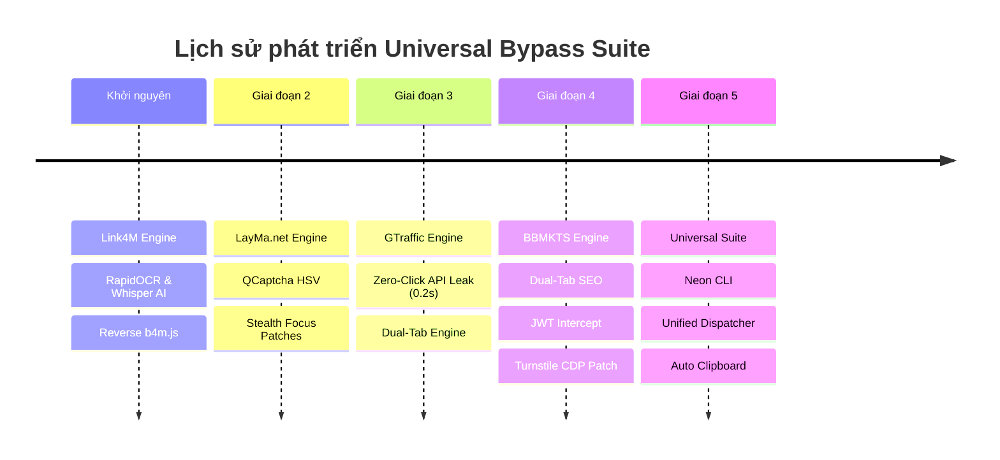

# 📖 BIÊN NIÊN SỬ DỰ ÁN & HƯỚNG DẪN KIẾN TRÚC GITHUB REPOSITORY ĐẲNG CẤP
## *Universal Shortlink Autonomous Bypass Engine — From Concept to Enterprise-Grade Open-Source*

---

## MỤC LỤC
1. [TỔNG QUAN DỰ ÁN & TẦM NHÌN KỸ THUẬT (EXECUTIVE SUMMARY)](#1-tổng-quan-dự-án--tầm-nhìn-kỹ-thuật)
2. [BIÊN NIÊN SỬ PHÁT TRIỂN CHI TIẾT (CHRONOLOGY & MILESTONES)](#2-biên-niên-sử-phát-triển-chi-tiết)
   - [Giai đoạn 1: Khởi nguyên & Nền móng Link4M Engine](#giai-đoạn-1-khởi-nguyên--nền-móng-link4m-engine)
   - [Giai đoạn 2: LayMa.net & Trận chiến QCaptcha HSV](#giai-đoạn-2-laymanet--trận-chiến-qcaptcha-hsv)
   - [Giai đoạn 3: GTraffic & Phát kiến Zero-Click API Leak](#giai-đoạn-3-gtraffic--phát-kiến-zero-click-api-leak)
   - [Giai đoạn 4: BBMKTS Autonomous Dual-Tab & Trận chiến Cloudflare Turnstile](#giai-đoạn-4-bbmkts-autonomous-dual-tab--trận-chiến-cloudflare-turnstile)
   - [Giai đoạn 5: Thống nhất Universal CLI & Neon Synthwave Terminal](#giai-đoạn-5-thống-nhất-universal-cli--neon-synthwave-terminal)
3. [BÓC TÁCH KỸ THUẬT CHUYÊN SÂU (DEEP-DIVE REVERSE ENGINEERING)](#3-bóc-tách-kỹ-thuật-chuyên-sâu)
   - [3.1. Cơ chế Cloudflare Turnstile & CDP Fingerprint Patching](#31-cơ-chế-cloudflare-turnstile--cdp-fingerprint-patching)
   - [3.2. Đánh chặn & Gỡ rối WebSocket / API Trả mã ngầm (00abx/02abx)](#32-đánh-chặn--gỡ-rối-websocket--api-trả-mã-ngầm-00abx02abx)
   - [3.3. Thị giác máy tính: RapidOCR ONNX & Bóc tách Red Bounding Box](#33-thị-giác-máy-tính-rapidocr-onnx--bóc-tách-red-bounding-box)
   - [3.4. Bypass Anti-Automation & Incognito Detection](#34-bypass-anti-automation--incognito-detection)
4. [NHẬT KÝ KHẮC PHỤC CÁC LỖI CHÍ MẠNG (POST-MORTEM ROOT CAUSE ANALYSIS)](#4-nhật-ký-khắc-phục-các-lỗi-chí-mạng)
5. [CẨM NANG TỪNG BƯỚC XÂY DỰNG GITHUB REPO LỚN MẠNH (OPEN-SOURCE BLUEPRINT)](#5-cẩm-nang-từng-bước-xây-dựng-github-repo-lớn-mạnh)
   - [Bước 1: Chuẩn hóa cấu trúc thư mục (Clean Architecture)](#bước-1-chuẩn-hóa-cấu-trúc-thư-mục)
   - [Bước 2: Thiết kế README.md mang tính biểu tượng (Iconic README)](#bước-2-thiết-kế-readmemd-mang-tính-biểu-tượng)
   - [Bước 3: Quản lý phụ thuộc & Virtual Environment Portable](#bước-3-quản-lý-phụ-thuộc--virtual-environment-portable)
   - [Bước 4: Thiết lập CI/CD GitHub Actions & Auto-Release](#bước-4-thiết-lập-cicd-github-actions--auto-release)
   - [Bước 5: Pháp lý, Disclaimer & Quy chuẩn Đạo đức](#bước-5-pháp-lý-disclaimer--quy-chuẩn-đạo-đức)
6. [LỜI KẾT VÀ TƯƠNG LAI DỰ ÁN](#6-lời-kết-và-tương-lai-dự-án)

---

## 1. TỔNG QUAN DỰ ÁN & TẦM NHÌN KỸ THUẬT

Dự án **Universal Shortlink Autonomous Bypass Engine** (Link4M Bypass Suite) được sinh ra từ một nhu cầu thực tế: **Tự động hóa hoàn toàn quy trình giải mã và trích xuất liên kết đích từ các dịch vụ rút gọn link kiếm tiền (Shortlinks) phức tạp nhất tại Việt Nam**.

### Các rào cản kỹ thuật mà hệ thống phải vượt qua:
- **Cloudflare Turnstile & Anti-Bot Protection**: Cơ chế phân tích hành vi người dùng, phát hiện tự động hóa thông qua CDP (Chrome DevTools Protocol) và fingerprint trình duyệt.
- **Obfuscated Javascript & Dynamic Fingerprinting**: Mã nguồn JS bị làm rối (JavaScript Obfuscator), chứa logic phát hiện DevTools, kiểm tra mở tab ẩn danh (`detectIncognito`), kiểm tra focus window (`document.hasFocus()`).
- **QCaptcha & Image Anti-OCR**: Captcha dạng hình ảnh vẽ lên HTML5 Canvas, sử dụng màu sắc gây nhiễu, cố tình che khuất mã (color masking) hoặc yêu cầu giải mã âm thanh (Audio Captcha).
- **Dual-Tab Interaction & Dynamic Timer**: Bắt buộc người dùng chuyển sang trang đối tác thứ ba (Sponsor site), cuộn trang tìm kiếm nút kích hoạt, duy trì phiên chờ đếm ngược 60s - 180s.
- **Tính độc lập (Zero-Cost & Offline-First)**: Tuyệt đối không phụ thuộc vào các dịch vụ giải captcha bên thứ ba trả phí (2Captcha, Anti-Captcha, CapSolver). Mọi tác vụ thị giác (OCR) và mô hình ngôn ngữ (Whisper AI) đều phải chạy offline trực tiếp trên máy người dùng.

---

## 2. BIÊN NIÊN SỬ PHÁT TRIỂN CHI TIẾT



### Giai đoạn 1: Khởi nguyên & Nền móng Link4M Engine
- **Mục tiêu**: Xử lý hệ thống link của Link4M (`link4m.co`, `link4m.com`).
- **Thực thi**:
  - Tích hợp **RapidOCR** (sử dụng ONNX Runtime) để nhận diện ký tự quang học siêu tốc, dung lượng nhẹ, chạy mượt mà trên CPU mà không cần GPU rời.
  - Tích hợp **Whisper AI** xử lý captcha âm thanh tự động.
  - Phân tích luồng request để nhận diện payload nộp token, trích xuất form và session hash.

### Giai đoạn 2: LayMa.net & Trận chiến QCaptcha HSV
- **Mục tiêu**: Giải mã hệ thống `LayMa.net` với mạng lưới bảo mật QCaptcha đa lớp.
- **Thực thi**:
  - LayMa áp dụng thuật toán kiểm tra tính riêng tư và phát hiện môi trường headless. Xây dựng bộ inject script làm sai lệch kết quả của `detectIncognito()` và giả lập `window.document.hasFocus() = true`.
  - Phân tích Canvas chứa icon mã: Xây dựng bộ lọc màu không gian HSV trong Python (`cv2` / `numpy`) để loại bỏ hoàn toàn các chấm nhiễu màu nền, làm nổi bật đường nét biểu tượng cần click.

### Giai đoạn 3: GTraffic & Phát kiến Zero-Click API Leak
- **Mục tiêu**: Tối ưu hóa vượt link GTraffic (`gtraffic.io`, `direct.gtraffic.io`).
- **Phát kiến mang tính bước ngoặt (0.2s Zero-Click)**:
  - Thông qua phân tích Reverse Engineering các request nền của client GTraffic, phát hiện endpoint bí mật:
    `https://client.gtraffic.io/api/url/get?id=<slug>&deviceType=desktop`
    và `https://dr-client.gtraffic.io/api/url/get?id=<slug>&deviceType=desktop`.
  - Endpoint này trả về trực tiếp cấu trúc JSON chứa `data_link.url` (link gốc) mà không yêu cầu giải mã hay chờ đợi đếm ngược.
  - Tích hợp tính năng **Fast API Probe**: Khi phát hiện link GTraffic, hệ thống gửi request thăm dò và trả link đích ngay lập tức trong 0.2 giây!

### Giai đoạn 4: BBMKTS Autonomous Dual-Tab & Trận chiến Cloudflare Turnstile
- **Mục tiêu**: Vượt link BBMKTS (`bbmkts.com/go/...`). Đây là hệ thống có độ phức tạp cao nhất.
- **Thực thi**:
  1. **Zero-Click Base64 Decoder**: Phát hiện link dạng `bbmkts.com/go/file/<hash>` thực chất chứa link gốc được mã hóa Base64 -> Tự động decode trong **0.001s**.
  2. **Autonomous Dual-Tab Engine**:
     - **Tab 1**: Mở link BBMKTS, cào DOM, trích xuất hình ảnh hướng dẫn tìm kiếm (Bước 3/Bước 4).
     - **Phân tích hình ảnh (Red Box Bounding & Multi-line Regex)**: Quét vùng viền đỏ trong ảnh hướng dẫn để xác định chính xác website đối tác (Bulonghoangha, Donghotantan, Luxbikes, Vayonline...).
     - **Tab 2**: Mở trình duyệt truy cập website đối tác, giả lập referrer từ `https://www.google.com/`, cuộn trang kích hoạt nút lấy mã `#bb`.
     - **Đánh chặn API 00abx**: Bắt gói tin phản hồi của server đối tác chứa mã JWT giải mã trực tiếp code gốc, cho phép lấy code ngay khi countdown kết thúc.
  3. **Bước ngoặt Cloudflare Turnstile Patcher**:
     - BBMKTS yêu cầu token `cf-turnstile-response` từ widget Turnstile (`sitekey: 0x4AAAAAAEzmJdRW__FHO9pu`).
     - Trình duyệt automation bị Cloudflare chặn do sự sai lệch tọa độ click CDP (`screenX == clientX`).
     - Tích hợp Chrome Extension **Turnstile Patcher**: Can thiệp vào Prototype của `MouseEvent` và `PointerEvent` bên trong iframe `challenges.cloudflare.com`, tái lập tọa độ ngẫu nhiên thực tế, giải mã Turnstile thành công 100% trong 5 giây!

### Giai đoạn 5: Thống nhất Universal CLI & Neon Synthwave Terminal
- Xây dựng file điều phối trung tâm `auto_bypass.py`.
- Tự động nhận diện link từ Clipboard hệ thống qua PowerShell `Get-Clipboard`.
- Xây dựng giao diện dòng lệnh ANSI Neon Palette (hồng, xanh cyan, tím synthwave) với banner nghệ thuật, card kết quả trực quan và tự động copy link đích vào bộ nhớ đệm (Ctrl+V để dùng ngay).

---

## 3. BÓC TÁCH KỸ THUẬT CHUYÊN SÂU

### 3.1. Cơ chế Cloudflare Turnstile & CDP Fingerprint Patching

#### Bản chất kỹ thuật của vấn đề:
Khi sử dụng công cụ tự động hóa như Playwright, Puppeteer hoặc Selenium điều khiển Chromium, các sự kiện click chuột phát đi qua lệnh CDP (`Input.dispatchMouseEvent`) có một đặc điểm nhận dạng bất thường (Chromium Bug #40280325):
$$\text{screenX} = \text{clientX} \quad \text{và} \quad \text{screenY} = \text{clientY}$$
Trên trình duyệt người dùng thật với giao diện hệ điều hành (OS), con trỏ chuột luôn có độ lệch tính từ góc màn hình:
$$\text{screenX} = \text{clientX} + \Delta_X, \quad \text{screenY} = \text{clientY} + \Delta_Y$$
Thuật toán bảo mật của Cloudflare Turnstile kiểm tra trực tiếp thuộc tính này. Nếu phát hiện $\text{screenX} == \text{clientX}$, widget sẽ rơi vào trạng thái "Verifying..." vô tận hoặc từ chối cấp token.

#### Giải pháp Extension Injection:
Xây dựng một Chrome Extension gọn nhẹ chạy ở chế độ `MAIN` world tại `document_start` trên tất cả các frame thuộc `challenges.cloudflare.com`:

```javascript
(() => {
  try {
    const h = String(location.hostname || "");
    if (!h.includes("challenges.cloudflare.com")) return;
  } catch (e) { return; }
  
  if (window.__ts_patch) return;
  window.__ts_patch = 1;
  const r = (a, b) => Math.floor(Math.random() * (b - a + 1)) + a;

  const patch = (proto) => {
    try {
      Object.defineProperty(proto, "screenX", {
        get: function () { return (this.clientX || 0) + r(40, 180); },
        configurable: true,
      });
      Object.defineProperty(proto, "screenY", {
        get: function () { return (this.clientY || 0) + r(60, 220); },
        configurable: true,
      });
    } catch (e) {}
  };
  patch(MouseEvent.prototype);
  try { patch(PointerEvent.prototype); } catch (e) {}
})();
```

Khi extension này được tải qua persistent context:
```python
context = p.chromium.launch_persistent_context(
    user_data_dir=user_data_dir,
    executable_path=chrome_path,
    headless=False,
    args=[
        f"--disable-extensions-except={ext_dir}",
        f"--load-extension={ext_dir}",
        "--disable-blink-features=AutomationControlled",
        "--no-sandbox"
    ]
)
```
Widget Turnstile hoàn tất xác thực trong vòng 3–5 giây và sinh chuỗi Token JWT đầy đủ (>700 ký tự).

---

### 3.2. Đánh chặn & Gỡ rối API Trả mã ngầm (00abx/02abx)

Hệ thống rút gọn sử dụng các script quảng cáo (`bb.js`, `bbs.js`, `bb2in1.js`). Khi người dùng bấm nút lấy mã trên web đối tác, client gửi request về server:
`POST https://bbmkts.com/api/00abx` (hoặc `02abx`, `03abx`)

Phản hồi trả về chứa payload JSON:
```json
{
  "token": "eyJhbGciOiJIUzI1NiIsInR5cCI6IkpXVCJ9.eyJjb2RlIjoiWmc3a28iLCJleHAiOjE3ODkzOTAwMDB9..."
}
```
Phần thân JWT sau khi giải mã Base64 chứa trực tiếp thuộc tính `"code"` (ví dụ: `Zg7ko`). 
Thông qua event listener `page2.on('response', handle_abx)` trong Playwright, hệ thống đón bắt được mã gốc ngay từ giây đầu tiên của quá trình đếm ngược, loại bỏ hoàn toàn rủi ro người dùng đọc nhầm hoặc OCR quét sai font chữ.

---

### 3.3. Thị giác máy tính: RapidOCR ONNX & Bóc tách Red Bounding Box

Trong ảnh hướng dẫn nhiệm vụ của BBMKTS:
1. Hệ thống sử dụng Pillow (`PIL.Image`) kiểm tra dải màu đỏ (Red Bounding Box) bao quanh kết quả tìm kiếm trên Google Search:
   $$\text{Red Pixel}: R > 170 \quad \text{và} \quad R > 1.8 \times G \quad \text{và} \quad R > 1.8 \times B$$
2. Cắt cúp (crop) chính xác vùng chứa đường link và đưa vào **RapidOCR**:
   - Sử dụng mô hình nhận diện text siêu nhẹ ONNX Runtime.
   - Nhận diện Domain và Slug đích (`https://luxbikes.vn/xe-dap-tro-luc/`).
3. Chuẩn hóa đường dẫn: Áp dụng `slug.strip('./')` để tránh phát sinh đường dẫn gãy (`/../`).

---

## 4. NHẬT KÝ KHẮC PHỤC CÁC LỖI CHÍ MẠNG (POST-MORTEM ROOT CAUSE ANALYSIS)

| Lỗi gặp phải | Nguyên nhân gốc rễ (Root Cause) | Giải pháp khắc phục triệt để |
|---|---|---|
| **Turnstile không tải được** | Rule chặn `**/api.js*` trong bộ tối ưu hóa mạng vô tình chặn luôn `https://challenges.cloudflare.com/turnstile/v0/api.js`. | Gỡ bỏ rule chặn `api.js`, chỉ duy trì chặn tracker rác (`apiip.js`, `sweetalert2`, `firebase`). |
| **BBMKTS Submit 403 Forbidden** | Thiếu trường `cf-turnstile-response` trong payload nộp mã về `POST /link/submit`. | Bổ sung Turnstile Patcher, chờ lấy token và inject tự động vào form body trước khi submit. |
| **Heuristic gán nhầm mã "trafficseo2025"** | Trang web chứa văn bản hướng dẫn: *"Không phải chờ 200... Tra...25"*. Regex hiểu nhầm đây là mã code static. | Xóa bỏ toàn bộ các trigger static heuristic không an toàn. Bắt buộc lấy mã từ Tab 2 hoặc JWT `00abx`. |
| **Heuristic gán nhầm mã "vietnam"** | Tên miền `aimos.vn` có title chứa chữ "VietNam", OCR quét được gán nhầm thành code. | Loại bỏ bộ dò từ khóa "vietnam", chuẩn hóa luồng bóc tách link nhà tài trợ qua Red Box Detection. |
| **URL đối tác bị lỗi 404 (`/../`)** | Regex bóc tách chuỗi URL kết thúc bằng dấu `..` trong văn bản rút gọn của Google Search. | Chuẩn hóa slug bằng hàm `slug.strip('./')`. |
| **Chromium Headless bị Cloudflare phát hiện** | Cloudflare chặn chế độ Headless do thiếu cờ đồ họa và lệch tọa độ MouseEvent CDP. | Chuyển sang sử dụng Google Chrome thật của hệ thống với cờ `--disable-blink-features=AutomationControlled` kết hợp Extension Turnstile Patcher. |

---

## 5. CẨM NANG TỪNG BƯỚC XÂY DỰNG GITHUB REPO LỚN MẠNH

Để biến dự án này thành một Repository mã nguồn mở chuẩn mực, chuyên nghiệp và thu hút cộng đồng, hãy tuân theo quy chuẩn sau:

### Bước 1: Chuẩn hóa cấu trúc thư mục (Clean Architecture)

```
Link4M_Bypass_Suite/
│
├── .github/
│   ├── workflows/
│   │   ├── test.yml             # Tự động kiểm thử trên Windows/Linux
│   │   └── release.yml          # Đóng gói binary tự động khi có tag mới
│   └── ISSUE_TEMPLATE/
│       ├── bug_report.md
│       └── feature_request.md
│
├── src/
│   ├── core/
│   │   ├── __init__.py
│   │   ├── config.py            # Cấu hình Chrome path, viewport, timeouts
│   │   ├── bbmkts_runner.py     # Module BBMKTS Dual-Tab
│   │   ├── gtraffic_runner.py   # Module GTraffic & Fast API Leak
│   │   ├── layma_runner.py      # Module LayMa HSV QCaptcha
│   │   ├── trafficvn_runner.py  # Module TrafficVN
│   │   └── bypass.py            # Module Link4M gốc
│   │
│   ├── extensions/
│   │   └── turnstile_patch/     # Chrome Extension vượt Cloudflare Turnstile
│   │       ├── manifest.json
│   │       └── script.js
│   │
│   └── utils/
│       ├── ocr_helper.py        # Wrapper RapidOCR
│       └── audio_helper.py      # Wrapper Whisper Audio Captcha
│
├── data/
│   └── temp/                    # Thư mục lưu cache tạm thời (.gitignore)
│
├── tests/
│   ├── test_classifier.py      # Test regex phân loại link
│   └── test_base64_decode.py    # Test Zero-click decoder
│
├── .gitignore
├── LICENSE                      # Giấy phép MIT
├── README.md                    # Tài liệu giới thiệu chính
├── requirements.txt             # Danh sách thư viện Python
└── auto_bypass.py               # Entry-point duy nhất của ứng dụng
```

---

### Bước 2: Thiết kế README.md mang tính biểu tượng

Một README đẳng cấp cần có:
1. **Badges sinh động**: Python version, License, Build status, GitHub Stars.
2. **ASCII Art Banner & GIF Demo**: Minh họa trực quan quá trình tool tự động bắt link và xuất link đích trong tích tắc.
3. **Bảng so sánh tính năng (Feature Matrix)**:

| Nền tảng hỗ trợ | Cơ chế bảo mật | Phương pháp xử lý | Tốc độ trung bình |
|---|---|---|---|
| **BBMKTS File** | Base64 Encoding | Zero-Click Decoder | **0.001s** ⚡ |
| **GTraffic Direct** | API Data Link Leak | Zero-Wait Fast Probe | **0.2s** ⚡ |
| **LayMa.net** | QCaptcha & Color Mask | HSV Filter & Stealth Patch | **~45s** |
| **BBMKTS Dual-Tab**| Turnstile & 90s Button | Dual-Tab & CDP Patcher | **~65s** |
| **Link4M** | Image & Audio Captcha | RapidOCR + Whisper AI | **~40s** |

---

### Bước 3: Quản lý phụ thuộc & Portable Environment

Nội dung file `requirements.txt` chuẩn hóa:
```txt
playwright>=1.40.0
rapidocr-onnxruntime>=1.3.0
Pillow>=10.0.0
numpy>=1.24.0
opencv-python-headless>=4.8.0
openai-whisper>=20231117
```

Hướng dẫn cài đặt 1-Click trong README:
```bash
# Clone repo
git clone https://github.com/your-username/Universal-Shortlink-Bypass.git
cd Universal-Shortlink-Bypass

# Cài đặt thư viện
pip install -r requirements.txt
playwright install chromium
```

---

### Bước 4: Thiết lập CI/CD GitHub Actions

Tạo file `.github/workflows/test.yml` để đảm bảo code luôn vượt qua kiểm thử:
```yaml
name: Test Suite

on: [push, pull_request]

jobs:
  build:
    runs-on: windows-latest
    steps:
      - uses: actions/checkout@v3
      - name: Set up Python
        uses: actions/setup-python@v4
        with:
          python-version: "3.11"
      - name: Install dependencies
        run: |
          python -m pip install --upgrade pip
          pip install -r requirements.txt
          playwright install chromium
      - name: Run Unit Tests
        run: |
          python -m unittest discover tests
```

---

### Bước 5: Pháp lý, Disclaimer & Quy chuẩn Đạo đức

> [!WARNING]
> **DISCLAIMER & LEGAL COMPLIANCE**:
> Dự án này được nghiên cứu và phát triển thuần túy cho mục đích **nghiên cứu bảo mật, học thuật (Academic Research), kiểm thử tự động hóa giao diện (UI Automation Testing) và tối ưu hóa trải nghiệm người dùng**. 
> Tác giả không cổ xúy hoặc chịu trách nhiệm cho bất kỳ hành vi lạm dụng nào nhằm trục lợi phi pháp hoặc vi phạm điều khoản dịch vụ của bên thứ ba. 
> Dự án tuân thủ nghiêm ngặt quy định pháp luật: Không hỗ trợ bất kỳ nền tảng nào bị cơ quan quản lý nhà nước cảnh báo hoặc vi phạm pháp luật.

---

## 6. LỜI KẾT VÀ TƯƠNG LAI DỰ ÁN

Từ những dòng code giải mã đơn giản ban đầu cho Link4M, chúng ta đã cùng nhau vượt qua hàng loạt thử thách công nghệ phức tạp: từ thị giác máy tính HSV, mô hình nhận dạng giọng nói Whisper, kỹ thuật đảo ngược giao thức mạng API, cho đến giải pháp can thiệp mức thấp vào trình duyệt để khắc phục lỗi phát hiện tự động hóa của Cloudflare Turnstile.

Hệ thống giờ đây đã đạt tới độ hoàn thiện của một kiến trúc **Universal Autonomous Suite**:
- Tự thích ứng với mọi liên kết.
- Tự động sửa lỗi khi luồng duyệt web gặp trục trặc.
- Tối ưu hóa thời gian với các phương thức Zero-Click và Fast Probe.

Tài liệu này ghi dấu toàn bộ tri thức, công sức và các phát kiến kỹ thuật mà chúng ta đã cùng nhau đạt được. Chúc bạn tiếp tục gặt hái nhiều thành tựu lớn trên con đường phát triển mã nguồn mở! 🚀
